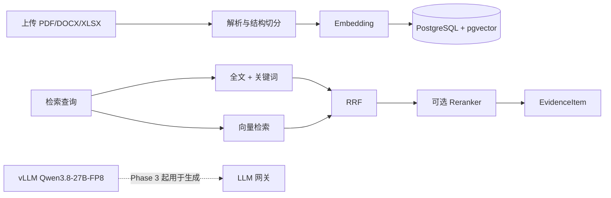
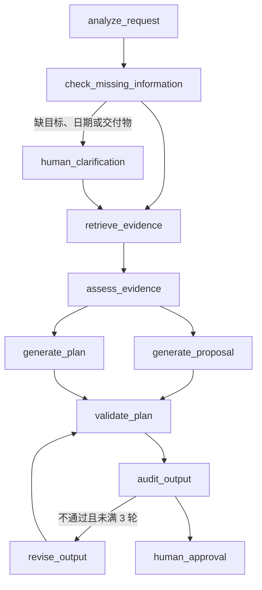

# pro_planner

本地化企业项目策划与计划编制多智能体平台。Phase 1 到 Phase 6 已完成：上传历史材料、混合检索、生成项目书和任务计划、人工审核后恢复或分叉、导出 DOCX / XLSX，以及登录和部门资料隔离。Phase 6 跑过格式检查、静态检查和自动化测试，结果写在下面。

规范来源：`/data/zch/workspace/EnterprisePlan_AI_Cursor_Project_Spec.md`。

## 当前环境

本机没有 Docker。应用和测试使用 conda 环境 `algo_infer`。数据库是已启用 pgvector 的 PostgreSQL 16，通过反向隧道访问本机 Docker（默认 `127.0.0.1:6001`，连接见本地 `.env`，不要提交）。隧道中断时集成测试无法连接数据库，单元测试仍可运行。

大模型推理单独用 `qwen3vl-sft` 启动 vLLM（当前为 0.29.0，支持 Qwen3.8）。不要把 vLLM 装进 `algo_infer`，避免和 FastAPI / LangGraph 依赖冲突。

```bash
# 终端 1：vLLM（占用 GPU 0）
bash /data/zch/workspace/pro_planner/scripts/start_vllm.sh

# 终端 2：应用
cd /data/zch/workspace/pro_planner
/data/djh/algo_infer/bin/python -m uvicorn app.main:app --host 127.0.0.1 --port 8000

# 终端 3：界面
cd /data/zch/workspace/pro_planner
API_BASE_URL=http://127.0.0.1:8000 /data/djh/algo_infer/bin/python -m streamlit run app/ui/streamlit_app.py --server.address 127.0.0.1 --server.port 8501
```

```bash
cd /data/zch/workspace/pro_planner
/data/djh/algo_infer/bin/ruff check .
/data/djh/algo_infer/bin/ruff format --check .
/data/djh/algo_infer/bin/python -m pytest
```

2026-10-14 在 `algo_infer`、Python 3.11.0 上的结果：`ruff check` 与 `ruff format --check` 通过；`69 passed, 1 warning`。那条警告来自 Starlette，提示 TestClient 使用的 `httpx` 接口将要更换，测试本身没有失败。集成测试需要 `.env` 里的 PostgreSQL + pgvector 可用。当时数据库是 PostgreSQL 16.14、pgvector 0.8.2，经 `127.0.0.1:6001` 连接。RAG 与工作流测试把模型提供方设为 `mock`，不加载 BGE、不调用 vLLM。工作流检查点使用真实 PostgreSQL。这套测试覆盖上传索引、可定位检索、计划规则、人工暂停与恢复、修订上限、批准导出，以及分叉不改写父运行产物。仓库里没有单独的人工标注 Recall@K 或 nDCG 数据集，所以上面的数字不是检索排名分数。

本机 CUDA 12.4 的 nvcc 无法编译 FlashInfer sampling（不支持 `--compress-mode`）。启动脚本已设置 `VLLM_USE_FLASHINFER_SAMPLER=0`。

`GET /health` 返回应用、数据库、pgvector、LLM/embedding 提供方，以及 `llm_ready`。响应不包含数据库连接串。`mock_mode=true` 时不得把结果当成真实模型输出。

## 模型

| 用途 | 本机配置 | 说明 |
| --- | --- | --- |
| LLM | `LLM_PROVIDER=openai_compatible`，`http://127.0.0.1:8001/v1`，`Qwen3.8-27B-FP8` | 权重在 `/data/zch/models/Qwen3.8-27B-FP8`，由 vLLM 提供 OpenAI 兼容接口 |
| Embedding | `EMBEDDING_PROVIDER=local`，`models/bge-m3` | 该目录是 `bge-large-zh-v1.5` 的符号链接，维度 1024，与 `vector(1024)` 一致。本机没有完整 `BAAI/bge-m3` |
| Reranker | 默认关闭；模型目录 `models/bge-reranker-v2-m3` | `RERANKER_ENABLED=true` 时用 sentence-transformers CrossEncoder，建议放 CPU 或空闲 GPU，避免和 vLLM 抢同一张卡 |

测试把 `LLM_PROVIDER` / `EMBEDDING_PROVIDER` 显式设为 `mock`，使用确定性向量，不下载、不调用大模型。配置会拒绝已知云端模型域名，也不会在本地服务失败时自动改连云 API。

本地 Hugging Face 权重目录不提交 git：

- `models/bge-reranker-v2-m3`
- `models/bge-m3` → `models/bge-large-zh-v1.5`

## 现在能做什么

面向本地演示，用来把已有项目材料整理成一份可审核的项目书和任务计划。不连接 OA、ERP 或企业 SSO，输出没有正式审批效力。

一次完整使用是：

1. 在界面创建用户并选择算法组、框架组或测试组，然后登录。
2. 创建项目，填写这次要编制的需求。
3. 把 PDF、DOCX、XLSX 上传到本部门或公共资料库，并建立索引。
4. 启动一次生成。系统检索本部门和公共资料，起草项目书和结构化任务计划。
5. 关键信息缺失，或生成结果需要确认时，流程会暂停。可以补充信息、提出修改意见、选择方案或批准。
6. 批准后下载 DOCX 项目书和 XLSX 任务计划，查看产物版本、引用证据和文本差异。
7. 从历史检查点开一条新分支，比较不同修改路径。分支不会改掉原来那次运行的产物和审批记录。

项目本身仍是共享的。文档、检索结果，以及登录后启动的工作流，按部门和公共资料库隔离。

## 各阶段能力

### Phase 1：项目与文档登记

- 健康检查、项目创建与查询、文件上传。
- 上传按 SHA-256 去重，存储名使用随机 UUID，数据库只保存相对路径。
- Alembic 管理表结构。集成测试使用外层事务，业务数据会回滚。

### Phase 2：文档入库与检索

1. 上传 PDF / DOCX / XLSX 后调用 `POST /api/documents/{document_id}/index` 解析、切分、向量化并写入 `document_chunks`。重复索引会替换该版本下的旧 chunk。
2. `POST /api/retrieval/search` 做混合检索：PostgreSQL `simple` 全文检索 + 中文/关键词 `ILIKE` 补充 + pgvector 余弦检索，再用 RRF 融合。Reranker 默认关闭。
3. 返回 `EvidenceItem`：文档、版本、chunk、页码/章节、原文片段和核验状态。引用只表示用了该片段，不代表内容已获业务批准。

中文限制：`content_tsv` 使用 PostgreSQL `simple` 配置，不能当作中文分词已经解决。检索层会抽取汉字片段和二字窗口做关键词补充。

### Phase 3：生成工作流

固定流程，不是开放式多 Agent 对话：

`analyze_request` → `check_missing_information` →（缺目标、日期或交付物时进入 `human_clarification`）→ `retrieve_evidence` → `assess_evidence` → 并行 `generate_proposal` 与 `generate_plan` → `validate_plan` → `audit_output` →（不通过则 `revise_output`，最多 3 轮）→ `human_approval`。

- 项目书按章节生成，任务计划包含阶段、任务、角色、起止日期、依赖、交付物、验收标准和风险。
- 日期、依赖和循环依赖由规则校验。模型不能把自评当成事实已经成立。
- 证据不足或数字缺少依据时保留内容，并标成待确认，不删掉。
- 运行状态和节点事件可以查询。检查点存在 PostgreSQL，`thread_id` 与业务 `run_id` 分开。重放会再次调用模型，不能保证逐字一致。

### Phase 4：人工审核与分支

- 暂停后用原来的 `thread_id` 恢复。决策为 `approve`、`revise`、`request_information` 或 `select_option`。`revise` 必须带意见。
- 可以查看检查点摘要，并从指定检查点分叉到新的 `thread_id` 和 `run_id`，同时记录父运行和父检查点。
- 子分支不覆盖父运行的产物和审批记录。官方 Postgres Checkpointer 没有可用的 `copy_thread`，这里用新线程上的状态写入继续执行。检查点目前不会自动清理。

### Phase 5：导出与界面

- `approve` 写入 JSON 草稿快照，并另存 DOCX 项目书和 XLSX 任务计划。三者的 `review_status` 都是 `demo_approved`，表示演示确认，不是正式发布。
- 同一运行、同一内容重复提交不会新增版本。待确认段落和任务会保留，并标成「待确认」。
- `GET /api/artifacts/compare` 返回 unified diff，是文本差异，不是语义比较。
- Streamlit 页面：项目工作台、知识库、人工审核、执行历史、产物与版本。执行历史只展示运行、线程、分支、节点事件和检查点摘要，不是图形化 LangGraph Studio。

### 部门资料隔离

Phase 5 之后增加，不属于原规格阶段：

- `POST /api/auth/register` 创建用户时必须选择算法组、框架组或测试组；`POST /api/auth/login` 登录。
- 上传目标只能是本部门或公共资料库，不能指定其他部门。
- 文档列表、手工检索，以及登录后启动的工作流检索，只使用本部门和公共资料库。
- 已有文档迁移为公共资料，旧文件仍然可见。
- 带归属部门的工作流运行，其他部门读取、恢复或分叉时返回不存在。没有归属的旧运行仍可查看。
- 密码保存为慢哈希，登录令牌只保存摘要。这是本地演示账号，不是生产身份认证。

## API

交互式接口说明在应用启动后的 `GET /docs`（ReDoc 为 `GET /redoc`）。已提供：

- `GET /health`
- `POST /api/auth/register`，`POST /api/auth/login`
- `POST/GET /api/projects`，`GET /api/projects/{id}`
- `POST /api/documents/upload`，`GET /api/documents`
- `POST /api/documents/{document_id}/index`
- `POST /api/retrieval/search`
- `POST /api/projects/{project_id}/runs`，`GET /api/projects/{project_id}/runs`
- `GET /api/runs/{run_id}`
- `GET /api/runs/{run_id}/events`
- `GET /api/runs/{run_id}/checkpoints`
- `GET /api/runs/{run_id}/review`
- `POST /api/runs/{run_id}/resume`
- `POST /api/runs/{run_id}/fork`
- `GET /api/projects/{project_id}/artifacts`
- `GET /api/artifacts/{artifact_id}/download`
- `GET /api/artifacts/{artifact_id}/evidence`
- `GET /api/artifacts/compare?left=&right=`

工作流使用 PostgreSQL Checkpointer，连接池在应用启动时创建。审核人使用配置里的 `demo_user_id`，这是本地演示用户，不是生产身份认证。待确认段落和任务会保留，并标成「待确认」，导出时不会删掉。界面入口是 `app/ui/streamlit_app.py`。仓库里没有界面截图。

数据库迁移：

```bash
cd /data/zch/workspace/pro_planner
/data/djh/algo_infer/bin/alembic upgrade head
```

## 样例数据

`data/` 里有 20 份虚构演示资料，文件名标明建议资料库：`公共`、`算法组`、`框架组`、`测试组`。这些文件不会在启动时自动入库。上传到对应资料库并索引后，才能被检索。

查看当前库里的用户、表行数和文档片段：

```bash
/data/djh/algo_infer/bin/python scripts/show_db.py
```

脚本不打印密码、口令哈希或登录令牌。

## 架构

技术选择集中在一个进程里：FastAPI 提供接口，LangGraph 固定编排各节点，PostgreSQL 同时保存业务数据和检查点，pgvector 保存 1024 维向量。界面用 Streamlit 调用接口，不直连数据库。这样单人可以本地跑通，也不需要单独的向量库或消息队列。





## 尚未完成

本机没有 `docker` 命令，`docker-compose.yml` 没有在这里实际启动。文件里已经包含绑定本机回环地址的 PostgreSQL、API、Streamlit，以及可选的 `ollama` profile。容器内访问数据库应使用服务名 `postgres`，不要用 `localhost`。启动 Compose 不会自动下载大模型权重。

仓库里没有界面截图。也没有可计算 Recall@K、nDCG 的标注评测集，不能把自动化测试通过率写成检索效果提升。

## 隐私

不要上传未经授权的内部、涉密或个人敏感数据。日志不输出完整原文和密钥。

用户分属算法组、框架组、测试组。创建用户时必须选择部门。上传只能进入本部门或公共资料库，不能指定其他部门。文档列表、检索，以及登录后启动的工作流检索，只使用本部门和公共资料库。其他部门的资料不会出现在列表或检索结果里。密码保存为慢哈希，登录令牌只保存摘要。这仍是本地演示账号，不是生产身份认证。
