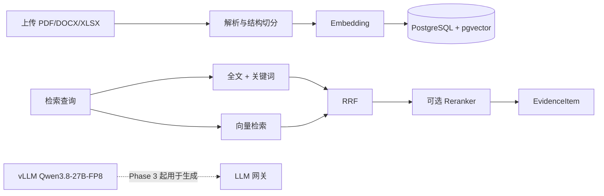

# pro_planner

本地化企业项目策划与计划编制多智能体平台。当前进度是 **Phase 5**：人工批准后导出 DOCX 项目书和 XLSX 任务计划，并用 Streamlit 提供项目工作台、知识库、审核、执行历史和产物版本页面。

规范来源：`/data/zch/workspace/EnterprisePlan_AI_Cursor_Project_Spec.md`。

## 当前环境

本机没有 Docker。应用和测试使用 conda 环境 `algo_infer`。数据库是已启用 pgvector 的 PostgreSQL 16，通过反向隧道访问本机 Docker（默认 `127.0.0.1:6001`，连接见本地 `.env`，不要提交）。隧道中断时集成测试无法连接数据库，单元测试仍可运行。

大模型推理单独用 `qwen3vl-sft` 启动 vLLM（当前为 0.29.0，支持 Qwen3.8）。不要把 vLLM 装进 `algo_infer`，避免和 FastAPI / LangGraph 依赖冲突。

```bash
# 终端 1：vLLM（占用 GPU 0）
bash /data/zch/workspace/pro_planner/scripts/start_vllm.sh

# 终端 2：应用
cd /data/zch/workspace/pro_planner
/data/djh/algo_infer/bin/python -m uvicorn app.main:app --host 127.0.0.1 --port 8000

# 终端 3：界面
cd /data/zch/workspace/pro_planner
API_BASE_URL=http://127.0.0.1:8000 /data/djh/algo_infer/bin/python -m streamlit run app/ui/streamlit_app.py --server.address 127.0.0.1 --server.port 8501
```

```bash
cd /data/zch/workspace/pro_planner
/data/djh/algo_infer/bin/python -m pytest
```

最近一次：`69 passed`（`algo_infer`，Python 3.11）。集成测试需要 `.env` 里的 PostgreSQL + pgvector 可用。RAG 与工作流测试把模型提供方设为 `mock`，不加载 BGE、不调用 vLLM。工作流检查点使用真实 PostgreSQL。

本机 CUDA 12.4 的 nvcc 无法编译 FlashInfer sampling（不支持 `--compress-mode`）。启动脚本已设置 `VLLM_USE_FLASHINFER_SAMPLER=0`。

`GET /health` 返回应用、数据库、pgvector、LLM/embedding 提供方，以及 `llm_ready`。响应不包含数据库连接串。`mock_mode=true` 时不得把结果当成真实模型输出。

## 模型

| 用途 | 本机配置 | 说明 |
| --- | --- | --- |
| LLM | `LLM_PROVIDER=openai_compatible`，`http://127.0.0.1:8001/v1`，`Qwen3.8-27B-FP8` | 权重在 `/data/zch/models/Qwen3.8-27B-FP8`，由 vLLM 提供 OpenAI 兼容接口 |
| Embedding | `EMBEDDING_PROVIDER=local`，`models/bge-m3` | 该目录是 `bge-large-zh-v1.5` 的符号链接，维度 1024，与 `vector(1024)` 一致。本机没有完整 `BAAI/bge-m3` |
| Reranker | 默认关闭；模型目录 `models/bge-reranker-v2-m3` | `RERANKER_ENABLED=true` 时用 sentence-transformers CrossEncoder，建议放 CPU 或空闲 GPU，避免和 vLLM 抢同一张卡 |

测试把 `LLM_PROVIDER` / `EMBEDDING_PROVIDER` 显式设为 `mock`，使用确定性向量，不下载、不调用大模型。配置会拒绝已知云端模型域名，也不会在本地服务失败时自动改连云 API。

本地 Hugging Face 权重目录不提交 git：

- `models/bge-reranker-v2-m3`
- `models/bge-m3` → `models/bge-large-zh-v1.5`

## Phase 2 能力

1. 上传 PDF / DOCX / XLSX 后调用 `POST /api/documents/{document_id}/index` 解析、切分、向量化并写入 `document_chunks`。
2. `POST /api/retrieval/search` 做混合检索：PostgreSQL `simple` 全文检索 + 中文/关键词 `ILIKE` 补充 + pgvector 余弦检索，再用 RRF 融合。
3. 返回 `EvidenceItem`：文档、版本、chunk、页码/章节、原文片段和核验状态。引用只表示用了该片段，不代表内容已获业务批准。

中文限制：`content_tsv` 使用 PostgreSQL `simple` 配置，不能当作中文分词已经解决。检索层会抽取汉字片段和二字窗口做关键词补充。

## API

已提供：

- `GET /health`
- `POST/GET /api/projects`，`GET /api/projects/{id}`
- `POST /api/documents/upload`，`GET /api/documents`
- `POST /api/documents/{document_id}/index`
- `POST /api/retrieval/search`
- `POST /api/projects/{project_id}/runs`，`GET /api/projects/{project_id}/runs`
- `GET /api/runs/{run_id}`
- `GET /api/runs/{run_id}/events`
- `GET /api/runs/{run_id}/checkpoints`
- `GET /api/runs/{run_id}/review`
- `POST /api/runs/{run_id}/resume`
- `POST /api/runs/{run_id}/fork`
- `GET /api/projects/{project_id}/artifacts`
- `GET /api/artifacts/{artifact_id}/download`
- `GET /api/artifacts/{artifact_id}/evidence`
- `GET /api/artifacts/compare?left=&right=`

上传文件按 SHA-256 去重，存储名使用随机 UUID，数据库只保存相对路径。重复索引会替换该版本下的旧 chunk。

工作流使用 PostgreSQL Checkpointer，连接池在应用启动时创建。`thread_id` 与业务 `run_id` 分开。检查点能恢复执行位置，但重放会再次调用模型，不能保证输出逐字一致。

恢复必须走原来的 `thread_id`，决策为 `approve`、`revise`、`request_information` 或 `select_option`。`revise` 必须带意见。审核人使用配置里的 `demo_user_id`，这是本地演示用户，不是生产身份认证。`approve` 会写入 JSON 草稿快照，并另存 DOCX 项目书和 XLSX 任务计划。三者的 `review_status` 都是 `demo_approved`，表示演示确认，不是正式发布。同一运行、同一内容重复提交不会新增版本。待确认段落和任务会保留，并标成「待确认」，导出时不会删掉。

`GET /api/artifacts/compare` 返回 unified diff。这是文本级差异，不是语义级版本比较。

分叉从指定 `checkpoint_id` 复制状态到新的 `thread_id` 和 `run_id`，并记录父运行与父检查点。分支不会改写父运行的产物和审批记录。官方 Postgres Checkpointer 没有可用的 `copy_thread`，这里用新线程上的状态写入继续执行。检查点目前不会自动清理。

界面在 `app/ui/streamlit_app.py`。执行历史页只展示运行、线程、分支、节点事件和检查点摘要，不是图形化 LangGraph Studio。仓库里没有界面截图。

数据库迁移：

```bash
/data/djh/algo_infer/bin/alembic upgrade head
```

## 架构



## 尚未完成

Docker Compose 里的 `ui` 服务会启动上述 Streamlit 入口。本机未安装 Docker，Compose 文件尚未在这里实际启动；容器网络里的模型服务仍按 `ollama` profile 预留。Phase 6 才会做格式检查和更完整的文档核对。

## 隐私

不要上传未经授权的内部、涉密或个人敏感数据。日志不输出完整原文和密钥。

用户分属算法组、框架组、测试组。创建用户时必须选择部门。上传只能进入本部门或公共资料库，不能指定其他部门。文档列表、检索，以及登录后启动的工作流检索，只使用本部门和公共资料库。其他部门的资料不会出现在列表或检索结果里。密码保存为慢哈希，登录令牌只保存摘要。这仍是本地演示账号，不是生产身份认证。
